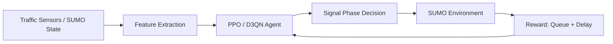

<!-- Profile README for Khushijangra/Khushijangra -->

# Khushi Jangra

**AI/ML Engineer &amp; Researcher**

Building production-grade intelligent systems across reinforcement learning, retrieval-augmented generation, graph neural networks, and recommendation systems.

B.Tech Computer Science &amp; Engineering (AI) · Bennett University, Greater Noida

---

## About

I design and implement AI systems at the intersection of intelligent decision-making, natural language understanding, and real-world engineering. My work spans reinforcement learning environments for urban infrastructure, agentic RAG pipelines for legal intelligence, GNN-based geospatial analysis, and explainable recommendation frameworks — many with published or submitted research backing.

I am interested in problems where the gap between a working prototype and a deployable, reliable system requires genuine systems thinking: environment design, evaluation rigor, and reproducibility.

Currently seeking AI/ML engineering internships and research collaborations.

---

## Technical Skills

| Domain | Technologies |
|---|---|
| **Languages** | Python, TypeScript, C++, Java, SQL |
| **ML / AI** | Scikit-learn, XGBoost, TF-IDF, Transformers, Embeddings, Vector Databases |
| **Deep Learning** | PyTorch, TensorFlow, PyTorch Geometric |
| **Reinforcement Learning** | PPO, DQN/D3QN, MAPPO, OpenAI Gymnasium, SUMO/TraCI |
| **Graph Neural Networks** | GCN, Graph Sage, Spatial Graph Construction |
| **NLP / RAG** | Hybrid Retrieval (BM25 + Semantic), Reciprocal Rank Fusion, LangChain concepts |
| **Computer Vision** | YOLOv8, Video Anomaly Detection, Transformer-based CV |
| **Backend / Full-Stack** | FastAPI, Node.js, Express, React, Next.js, Docker |
| **Databases** | PostgreSQL + PostGIS, Firebase, Supabase |
| **Data & Evaluation** | Pandas, NumPy, SciPy, Matplotlib, TensorBoard, Optuna |

---

## Featured Projects

### NEXUS-ATMS — Adaptive Traffic Signal Control
> Reinforcement learning-driven traffic management system replacing fixed-cycle signals with real-time adaptive control across urban intersections.

- **RL Agents:** PPO and D3QN trained on custom Gymnasium environments over Eclipse SUMO micro-simulation
- **Subsystems:** Emergency vehicle green-wave corridors, real-time carbon emission tracking, pedestrian safety modules
- **Architecture:**

**Stack:** Python · PyTorch · Eclipse SUMO · TraCI · Gymnasium  
[→ View Repository](https://github.com/Khushijangra/NEXUS-ATMS)

---

### argus-flow — Vision-Guided Traffic Incident Intelligence
> Extends NEXUS-ATMS with transformer-based video anomaly detection and a Next.js Digital Twin command center for incident-aware traffic recovery.

- Detects traffic anomalies (accidents, blockages) from live camera streams using severity scoring
- PPO recovery engine autonomously adapts signal phases in response to detected incidents
- Full-stack deployment: FastAPI backend + Next.js Digital Twin dashboard

**Stack:** Python · PyTorch · FastAPI · Next.js · SUMO · Docker  
[→ View Repository](https://github.com/Khushijangra/argus-flow)

---

### DriveLegal — Agentic Legal Intelligence Platform
> Multi-agent AI system for traffic law retrieval, compliance assessment, and legal explanation using Hybrid RAG with deterministic penalty calculation.

- **5-Agent Pipeline:** Query Analysis → Legal Retrieval → Legal Reasoning → Compliance Assessment → Response Synthesis
- **Hybrid RAG:** BM25 full-text search + semantic cosine similarity, merged via Reciprocal Rank Fusion (RRF)
- **Geospatial:** PostGIS for jurisdiction-aware law resolution; authority scoring (×1.2 for official gazettes)
- **Evaluation:** 92% retrieval accuracy · 89% context precision · ~158ms warm query latency

**Stack:** TypeScript · Node.js · PostgreSQL/PostGIS · React · Docker  
[→ View Repository](https://github.com/Khushijangra/drivelegal)

---

### Intern Setu — AI Internship Recommendation Engine
> Hybrid NLP recommendation system matching students to internships using TF-IDF similarity, fairness-aware reranking, and explainable ranking.

- Semantic TF-IDF vectorization with 100+ skill aliases, 50+ city aliases, 150+ education level normalizations
- Multi-factor scoring: cosine similarity + skill overlap + stipend + location + education match
- Fairness reranking: rural user boost, organizational diversity penalty, fallback expansion
- Explainability layer: matched skills list, location fit reason, per-recommendation score breakdown

**Stack:** Python · FastAPI · React · TypeScript · Scikit-learn · Firebase · Supabase  
[→ View Repository](https://github.com/Khushijangra/internship-recommendation-engine)

---

### PHERL-UCDI — Urban Heat Island Prediction & Intervention
> GCN-based platform for predicting urban heat islands from satellite data and generating Pareto-optimal cooling strategies under budget constraints.

- Spatial graph (9,555 nodes) over Ahmedabad fusing Landsat 8/9, Sentinel-2, ERA5, OpenStreetMap, and WorldPop data
- **GCN outperformed XGBoost:** RMSE 0.438°C vs 0.563°C, R² 0.902 vs 0.837
- Counterfactual intervention simulation and NSGA-II genetic algorithm for portfolio optimization
- Streamlit decision dashboard for policymakers

**Stack:** Python · PyTorch Geometric · Scikit-learn · Streamlit · NSGA-II  
[→ View Repository](https://github.com/Khushijangra/PHERL-UCDI)

---

### Sports Recommendation Engine — Explainable Youth Sports Matching
> Research implementation of Asymmetric Contribution Scoring (ACS) — a transparent MCDM framework for matching young athletes to developmentally appropriate sports.

- Dataset: 3,818 students (ages 5–18) across 20 sports disciplines, 11 schools
- Stepped non-linear contribution function replacing standard TOPSIS with interpretable sport-specific weight matrices
- Three-tier recommendation: Best Match / Growth Potential / Entry Sports with LTAD age safety filtering
- Validated: 100% monotonicity (36,000 tests), 92.2% ± 1.1% cross-fold stability, 0% top-1 change under ±20% weight perturbation

**Stack:** Python · Scikit-learn · XGBoost · Optuna · Pandas  
[→ View Repository](https://github.com/Khushijangra/sports-recommendation-engine)

---

## Currently Exploring

- Multi-agent coordination with shared graph representations (GNN + MAPPO)
- Evaluation frameworks for agentic RAG systems — measuring faithfulness and legal traceability
- Offline reinforcement learning for real-world traffic deployment without live simulation
- Physics-informed machine learning for geospatial prediction tasks

---

## Contact

**LinkedIn:** [linkedin.com/in/khushi-jangra](https://www.linkedin.com/in/khushi-jangra)  
**GitHub:** [github.com/Khushijangra](https://github.com/Khushijangra)  
**Email:** Available on LinkedIn
